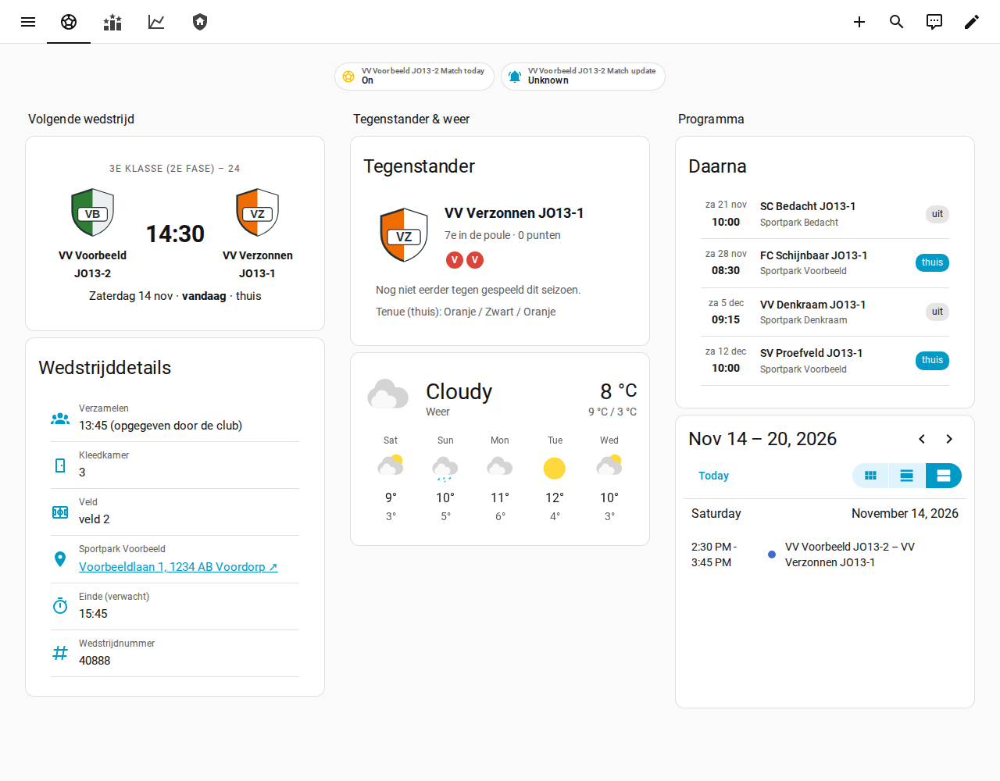
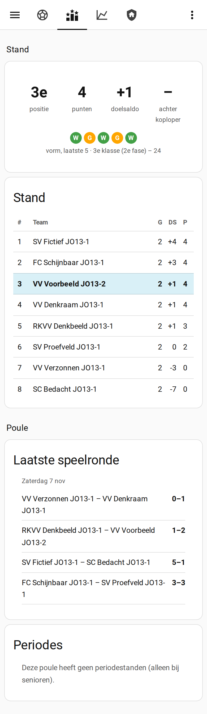
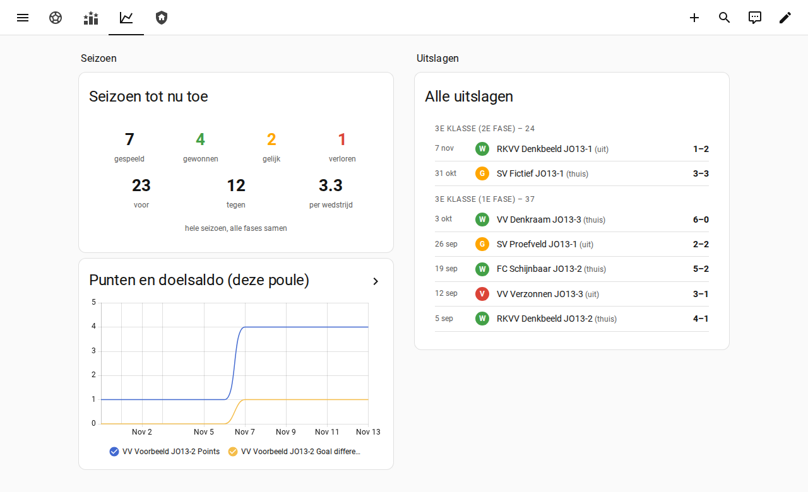
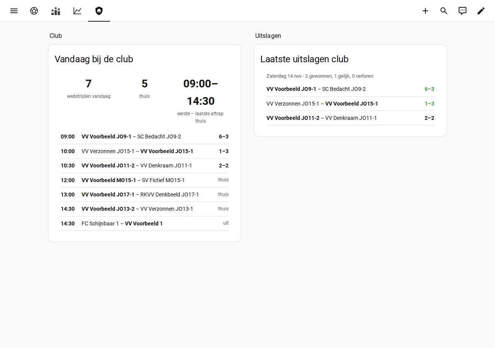
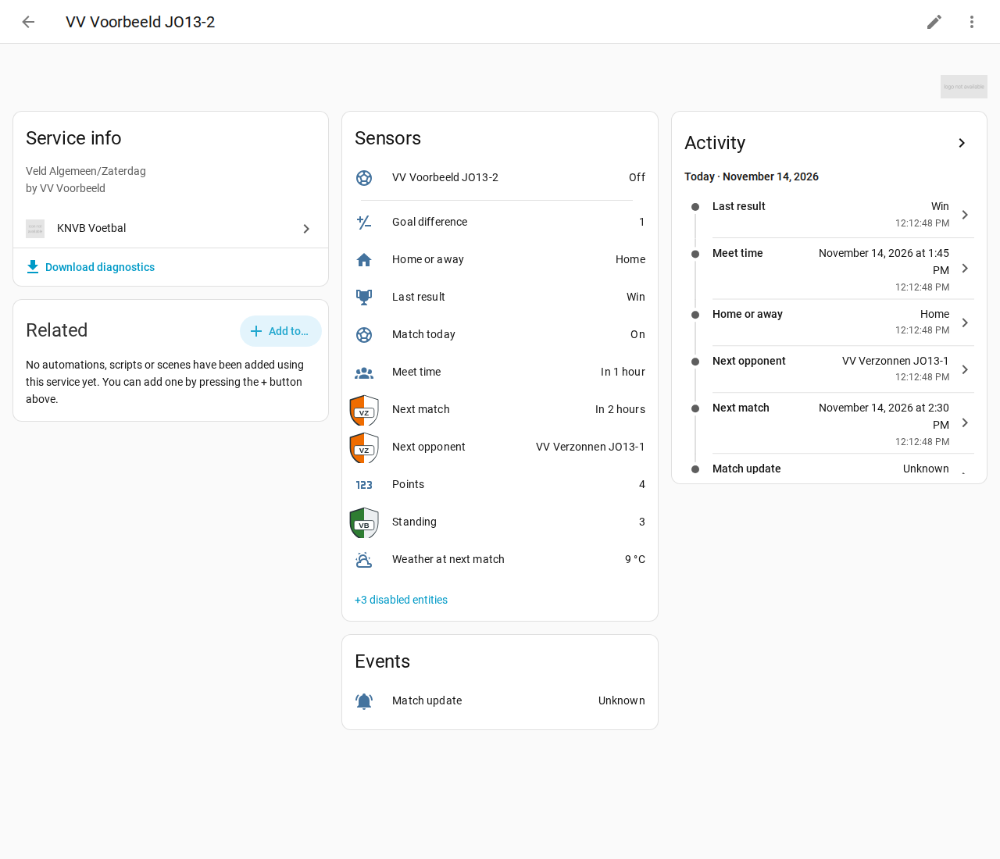

# KNVB Voetbal for Home Assistant

A [Home Assistant](https://www.home-assistant.io/) integration, installable through [HACS](https://hacs.xyz/),
for Dutch amateur football: the fixtures, results and standings of any team of any KNVB club.

> **Status: early (0.1).** It works, but it is new: expect rough edges, and please report them in the
> [issues](../../issues).

## Screenshots

An example dashboard built on the integration's entities ([examples/dashboard.yaml](examples/dashboard.yaml)),
shown with a made-up club and season:

| Match day | Standing (phone) |
|---|---|
|  |  |

| Season | Club |
|---|---|
|  |  |

The entities of a team, as Home Assistant shows them:

## What it does

Log in with your own (free) [voetbal.nl](https://www.voetbal.nl) account, then pick teams: the ones you
already follow in the voetbal.nl app, or any team of any club. Per team you get a device with:

| Entity | State | Details (attributes) |
|---|---|---|
| **Calendar** (named after the team) | on during a match | every match of the season, all phases and cup rounds: home – away, the score once played, venue and address; the description has the pitch, your team's dressing room and the departure time |
| **Next match** | kick-off time | opponent (with club logo, kit colours, position, points and recent form), home or away, venue, address, pitch, dressing room, meet time, the club's meet and departure times, match number, cup or league, expected end, the previous meeting with this opponent, and the matches after it |
| **Next opponent** | the opponent's name (with their logo) | home or away, kick-off, venue, club, their position, points and form |
| **Home or away** | home or away | the details of the next match |
| **Meet time** | when the team meets | the club's meet time (*verzameltijd*) or departure time (*vertrektijd*) when the club entered one; otherwise kick-off minus 30 minutes, or what you set (home and away separately) |
| **Match today** | on all day on match days | kick-off, meet time, opponent, venue, pitch, dressing room |
| **Match update** (event) | fires on a change | *called off*, *back on*, *rescheduled*, *venue or pitch changed*, *result*, with the details of the match |
| **Weather at next match** | temperature | optional: the forecast at kick-off from a weather entity you pick (chance of rain, feels-like, wind), from 48 hours before |
| **Last result** | win, draw or loss | score (with extra time and penalties), goals for and against, opponent, form (last 5) |
| **Standing** | position in the pool | points, played, won/drawn/lost, goals, goal difference, penalty points, points behind the leader, form, the season so far over all phases (played, won/drawn/lost, goals), period standings (*periodestanden*, senior pools), the latest round's results in the pool, and the whole table |
| **Points**, **Goal difference** (+ *Goals for*, *Goals against*, *Played*, off by default) | the number | with long-term statistics, so Home Assistant can graph the season |

- Youth teams change pools during the season (1st, 2nd, 3rd phase): all their matches stay in the
  calendar, and the *Standing* follows the current pool.
- Change alerts also catch what changed while Home Assistant was off: the integration remembers the
  matches as it last saw them.
- Called-off matches are left out of the calendar, as Home Assistant expects of calendars, so that
  automations on the calendar don't fire for them. The *Match update* entity reports them.
- Calendar events last as long as the match: the playing time of the age group (from the KNVB data:
  90 minutes for seniors, 60 for under-13s, …) plus half-time.
- An account doesn't need to belong to a club member: a spectator or parent account can follow any team.
- Data is fetched every 30 minutes, every 5 minutes around the team's own matches, and every few hours
  when there is nothing coming up.
- Dutch and English.

### Follow a whole club

**Add club** on the integration's page follows every team of a club, for example when several children
play there, or for whoever runs the canteen on Saturdays. The club gets a device with:

| Entity | State | Details |
|---|---|---|
| **Calendar** (named after the club) | on during a match | every match of every team: upcoming ones and the latest results |
| **Matches today** | number of matches | first and last kick-off, and each match: team, opponent, home or away, venue, score once played |
| **Home matches today** | number of home matches | the same, home matches only |
| **Latest results** | the date of the club's latest match day | won, drawn, lost, and each result |

### Actions

- `knvb_voetbal.get_matches`: the matches of a team (with venue, meet time and score) or a club, as a
  response, optionally upcoming ones only. For scripts, dashboards and voice assistants.
- `knvb_voetbal.get_standing`: the full standing of a team's pool, with each team's form, and the
  period standings.

If the voetbal.nl app changes its data service so that this version no longer fits, Home Assistant
shows a repair asking to update the integration.

### Example dashboard

[examples/dashboard.yaml](examples/dashboard.yaml) is the dashboard from the screenshots: match day,
standing, season and club, in Dutch. It needs the *HTML Jinja2 Template card* from HACS. Replace the
example entity ids with yours (instructions at the top of the file) and paste it into a new dashboard's
raw configuration editor. The graphs start at the beginning of the current pool: the integration fills
Home Assistant's statistics with the season so far.

### Team settings

*Settings → Devices & services → KNVB Voetbal → (team) → ⋮ → Reconfigure*: when the team meets for home
and away matches when the club has not entered a departure time (default 30 minutes before kick-off),
and optionally a weather entity for the *Weather at next match* sensor.

### Blueprints

Ready-made automations that send a notification to your phone (Home Assistant app), in Dutch or English:

| Blueprint | What it does | |
|---|---|---|
| Notify on match changes | a match is called off, back on, moved, or has a result |  |
| Reminder before meet time | a set time before the meet time, with venue, address, dressing room and weather |  |
| Match day summary | at a set time on match days: opponent, kick-off, meet time, venue, dressing room, weather |  |

## Installation

1. In HACS, add this repository as a custom repository (category *Integration*), install **KNVB
   Voetbal** and restart Home Assistant. Or copy `custom_components/knvb_voetbal` into your
   configuration's `custom_components` folder and restart.
2. **Settings → Devices & services → Add integration → KNVB Voetbal**, and log in with your voetbal.nl
   account. If the account follows teams in the app, you can pick those right away.
3. Add more teams with **Add team** on the integration's page: from the teams you follow, or by
   searching for a club and picking one of its teams.

One login serves all teams of that account. If the session ever ends, Home Assistant asks you to log in
again.

## How it works, and the catch

The data comes from the same API the official voetbal.nl app uses (run by Sportlink for the KNVB). There
is no public API without a login: the voetbal.nl website and its data require an account, and the
official alternative for clubs (Sportlink Club.Dataservice) needs a key per club.

So this integration **logs in the way the app does**: with your email and password once, after which it
only keeps a refresh token. That means it presents itself as the app. It is **not affiliated with or
endorsed by the KNVB or Sportlink**, and they can change or block this at any time; an app update may
also require an update here. If the KNVB or Sportlink asks us to change or stop something, we will.

**Privacy.** The integration only reads competition data: clubs, teams, matches, results, standings.
It never fetches team rosters or other personal data (rosters often list minors), and it doesn't store
your password.

## Contributing

Issues and pull requests are welcome, in English or Dutch.

- Read [docs/api.md](docs/api.md) for how the data source works.
- [tools/probe.py](tools/probe.py) is a small standalone script to explore the API from the command line,
  with your own account (see the script for the environment variables it needs).
- Planned work is tracked in the [issues](../../issues).

Please don't commit personal data (names, rosters, tokens, account details) in examples or tests; use
made-up or anonymised data.

## License

[MIT](LICENSE)
